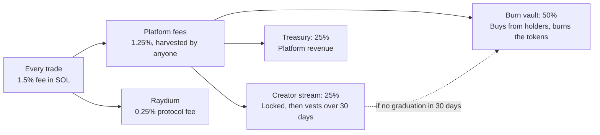

# Burn-vault launchpad: program spec

As of 15 November 2026.

A Solana launchpad on Raydium LaunchLab where each token's trading fees fund a
vault that buys tokens from holders and burns them, and where the creator's fee
share is locked until graduation and then vested. All numbers are starting
values to tune.

## Fee flow

Each trade's 1.5% fee leaves 1.25% for the platform, which is split 50/25/25.
The creator's share falls to the burn vault if the token has not graduated 30
days after launch. After graduation, locked-LP and pool fees follow the same
split, and any token-side fees are burned.

## Token lifecycle

A token moves through five stages, and the vault and the creator's share are
both gated on graduation.

1. **Launch.** One transaction creates the mint on a Raydium LaunchLab bonding
   curve, the token's launch record, its burn vault, its creator stream, and a
   per-token Raydium platform config owned by a program address. The fee split
   is written into the launch record and never changes. An optional first buy
   rides in the same transaction.
2. **Curve phase.** Every trade pays 1.5%. Anyone can call the harvest
   instruction, which claims the platform's fees and splits them 50% to the
   burn vault, 25% to the creator stream and 25% to the treasury. The vault and
   the stream only collect.
3. **Graduation.** When the curve reaches its target, Raydium migrates the
   token to a CPMM pool. All LP is locked, and the program address holds the
   fee rights, so pool fees keep flowing through the same split.
4. **Burn-vault trading.** Holders sell tokens to the vault at a discount to
   the pool price. The vault pays SOL and burns the tokens in the same
   instruction.
5. **Creator vesting.** At graduation the creator's accrued balance starts
   vesting linearly over 30 days. Later harvests add to the stream on the same
   schedule.

**If a token does not graduate within 30 days of launch**, anyone can expire
the creator stream. Its balance moves to the burn vault, and the creator's 25%
of later fees goes to the vault as well.

## Accounts

The program needs one global account and four per-token accounts, all
program-derived addresses.

| Account | Scope | Holds |
| --- | --- | --- |
| `GlobalConfig` | One | Admin key, treasury address, global pause flag, default vault parameters |
| `TokenLaunch` | Per mint | Mint, creator wallet, split in basis points, launch time, graduated flag, pool address, harvest totals |
| `LaunchAuthority` | Per mint | No data. Signs for the token's Raydium platform config and holds its LP fee rights |
| `BurnVault` | Per mint | SOL balance, vault parameters, current 24-hour window start and SOL spent, total tokens burned, paused flag |
| `CreatorStream` | Per mint | Locked SOL balance, vesting start, total vesting, amount claimed, expired flag |

The treasury is an ordinary wallet outside the program and should be a multisig.

## Instructions

Ten instructions cover the whole program; none of them can move vault SOL to
the admin.

| Instruction | Caller | What it does |
| --- | --- | --- |
| `initialize_config` | Admin, once | Creates `GlobalConfig` with the admin, treasury and default parameters |
| `create_launch` | Any creator | Calls LaunchLab to create the platform config and the curve pool, creates the four per-token accounts, records the split, runs the optional first buy |
| `harvest_fees` | Anyone | Claims the token's platform fees (and LP and pool fees after graduation) through `LaunchAuthority`, splits the SOL by the recorded split, burns any token-side fees |
| `mark_graduated` | Anyone | Verifies on-chain that the curve has migrated, records the pool address, opens the vault, starts creator vesting |
| `sell_to_vault` | Any holder | Checks the price guard and limits, pays SOL at the bid, burns the tokens. Takes a minimum-SOL-out argument |
| `claim_creator` | The creator | Pays out whatever has vested and not yet been claimed |
| `expire_creator` | Anyone | After the deadline, if not graduated, moves the creator balance to the burn vault and redirects the creator share |
| `set_vault_params` | Admin | Changes one vault's discount and limits, only within hard-coded bounds |
| `set_pause` | Admin | Pauses one vault or all vault sells. Never blocks `claim_creator` or `harvest_fees` |
| `update_config` | Admin | Rotates the admin key or treasury address |

## Parameters

Defaults follow BackBid's published values where they apply; the bounds are
proposals, since BackBid does not publish its own.

| Parameter | Default | Proposed bounds |
| --- | --- | --- |
| Platform fee on the curve | 1.25% (plus Raydium's 0.25%) | Set in the Raydium platform config; subject to Raydium's cap |
| Split: vault / creator / treasury | 50% / 25% / 25% | Immutable per token |
| Bid discount | 7.5% | 2% to 20% |
| Max per sale | 2% of vault SOL | 0.5% to 5% |
| Daily budget | 10% of vault SOL at window start | 2% to 25% |
| SOL reserve | 0.1 SOL | 0.05 to 1 SOL |
| TWAP window | 20 minutes | 10 to 60 minutes |
| Price guard | 15% spot-to-TWAP gap | 5% to 25% |
| Creator vesting | 30 days, linear, from graduation | Immutable per token |
| Creator expiry deadline | 30 days from launch without graduation | Immutable per token |

Bid formula: `bid = min(TWAP, spot) × (1 − discount)`. There is no ask and no
inventory cap, because the vault never holds tokens.

## Invariants and edge cases

These are the properties an auditor should be able to check directly against
the code.

**Invariants**

- Vault SOL leaves only as payment to a holder in `sell_to_vault`. No
  instruction pays the admin or treasury from a vault.
- Tokens the vault receives are burned in the same instruction, so its token
  balance is always zero.
- A token's split sums to 10,000 basis points and cannot change after launch.
- The creator cannot claim anything before graduation, and never more than has
  vested.
- Harvested fees can only go to that token's vault, its creator stream and the
  treasury.
- The bid always uses the lower of TWAP and spot, read on-chain at the time of
  the trade.
- All calls into Raydium use pinned program IDs and accounts derived inside the
  program.

**Edge cases**

- **Rounding:** each share rounds down and the remainder goes to the burn vault.
- **Window rollover:** the daily budget resets when a sale arrives more than 24
  hours after the window start.
- **Reserve:** a sale that would take the vault below its reserve is refused,
  not partially filled.
- **Price guard:** sales are refused while spot is further from TWAP than the
  guard allows.
- **Pause:** blocks vault sells only; creators can still claim and anyone can
  still harvest.
- **Wash trading by the creator:** each trade costs 1.5% and returns at most
  25% of the 1.25% platform fee, so it loses money.
- **Front-running:** the vault never buys from the pool, so there is no vault
  order to trade ahead of.

## Raydium integration

Raydium LaunchLab supplies the curve, the graduation and the pool; this program
only adds the vault, the stream and the fee routing.

- **Program and SDK:** the LaunchLab mainnet program is
  `LanMV9sAd7wArD4vJFi2qDdfnVhFxYSUg6eADduJ3uj`, with a separate devnet
  deployment. The TypeScript package is `@raydium-io/raydium-sdk-v2`, and
  Raydium publishes a CPI crate for on-chain calls
  ([SDK page](https://docs.raydium.io/raydium/pool-creation/launchlab/launchlab-typescript-sdk)).
- **Platform config:** `createPlatformConfig()` sets the fee rate, LP split and
  metadata
  ([guide](https://docs.raydium.io/raydium/launchlab/for-builders/creating-a-platform)).
  Raydium allows one platform per wallet, so each token gets its own config
  owned by its `LaunchAuthority` address, as BackBid does.
- **Fee rates:** total trade fee is the sum of the protocol, platform, creator
  and share rates, over a denominator of 1,000,000. Set the LaunchLab creator
  rate to zero; this program pays the creator itself.
- **LP at graduation:** `migrateCpLockNftScale` splits LP between platform,
  creator and burn shares summing to 1,000,000
  ([LP distribution](https://docs.raydium.io/raydium/build/tips-and-gotchas)).
  Lock the LP with the platform holding the fee rights, so pool fees keep
  funding the vault. Burned LP earns nothing.
- **Claiming:** the SDK names are `claimVaultPlatformFee()` for curve fees,
  `harvestLockLp()` for locked-LP fees and `collectCreatorFee()` for the pool's
  creator fee
  ([fee reference](https://docs.raydium.io/raydium/build/tips-and-gotchas/launchlab-and-cpmm-fee-reference)).
  `harvest_fees` calls the on-chain equivalents.
- **Recent changes:** since 17 August 2026 the creator's locked-LP share goes
  to the platform
  ([creator fees](https://docs.raydium.io/products/launchlab/creator-fees)),
  and a 26 August 2026 change caps the platform fee rate
  ([changelog](https://docs.raydium.io/reference/changelog/2026-08-26-launchlab-platform-fee-rate-cap.md)).
- **TWAP:** BackBid reads a 20-minute TWAP from the token's Raydium pool
  on-chain. The exact pool account to read still needs confirming.

## Off-chain services

Four services sit around the program, and none of them ever holds a user's keys.

- **API server:** builds and simulates every transaction with the Raydium SDK
  and returns it unsigned for the wallet to sign. It generates each mint
  keypair, co-signs the launch and discards the key. It stores token images and
  metadata.
- **Harvester:** a scheduled job that calls `harvest_fees` and `mark_graduated`
  for every token, since both are permissionless.
- **Indexer and database:** reads program and pool activity into a database
  that feeds the token lists, charts, burn totals and leaderboard.
- **Web app:** wallet connection through the Solana Wallet Standard (Phantom,
  Solflare, Backpack) and Sign-in with Solana.

Pages for the first version:

- Home with the token list (New, Trending, About to graduate, Graduated) and a
  stats bar
- Launch form with live preview and cost breakdown
- Token page with trading, sell-to-vault, and burn and vault figures
- Burn leaderboard
- Creator dashboard showing locked, vested and claimable SOL
- How it works, fees, security and risk pages

Also needed: a paid RPC provider and hosting.

## Open questions

The first one is a design gap, not a detail: under this spec, SOL in the vault
of a token that never graduates is stranded.

- [ ] **Stranded vault SOL.** A vault only opens at graduation. Options: let
  the vault buy from the curve and burn after the expiry deadline, or accept
  the loss as BackBid appears to.
- [ ] **TWAP source.** Confirm which Raydium CPMM account provides price
  history and that 20 minutes of it is available on-chain.
- [ ] **Fee claims by a program address.** Confirm in Raydium's IDL that a
  program-derived address can own a platform config and claim curve, LP and
  pool creator fees by CPI.
- [ ] **Platform fee cap.** Read the 26 August 2026 changelog and confirm 1.25%
  is allowed.
- [ ] **Graduation target.** BackBid graduates at 85 SOL. Confirm which curve
  settings a platform may choose.
- [ ] **Creator wallet rotation.** Decide whether a creator can move their
  stream to a new wallet.
- [ ] **Upgrade authority.** Multisig from day one, and whether to make the
  program immutable later.
- [ ] **Audit.** Choose a firm and budget before mainnet.
- [ ] **Legal review.** Jurisdiction, terms, risk disclosure, and how the vault
  is described. Avoid "price floor" or any guarantee.
- [ ] **Name and brand.**

## Sources

- [BackBid: How it works](https://backbid.fun/how-it-works/),
  [Fees](https://backbid.fun/fees/) and
  [Security](https://backbid.fun/security/)
- [Raydium: Creating a platform](https://docs.raydium.io/raydium/launchlab/for-builders/creating-a-platform)
- [Raydium: LaunchLab TypeScript SDK](https://docs.raydium.io/raydium/pool-creation/launchlab/launchlab-typescript-sdk)
- [Raydium: LaunchLab and CPMM fee reference](https://docs.raydium.io/raydium/build/tips-and-gotchas/launchlab-and-cpmm-fee-reference)
- [Raydium: Creator fees](https://docs.raydium.io/products/launchlab/creator-fees)

Raydium figures come from search results of its docs, not full page reads, so
check each against the live page before coding.
